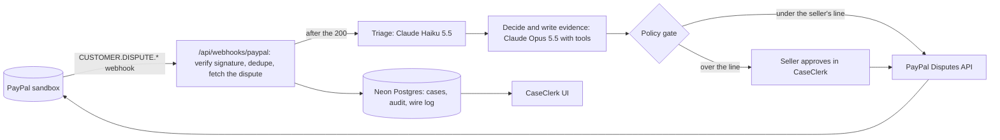

# CaseClerk

An AI dispute desk for small PayPal sellers. When a buyer's dispute or chargeback arrives, CaseClerk reads the order and the shipment tracking, decides whether to fight, refund or offer, writes the evidence pack and files it through PayPal's Disputes API before the deadline. Small cases it answers on its own, under the seller's rules. Above the seller's lines it stops and asks first.

Built for the PayPal AI Hackathon (2026). Everything runs on the PayPal **sandbox**.

**Hosted demo: https://caseclerk.vercel.app** (no login, no keys needed)

**Demo video:** VIDEO_LINK_TBD (YouTube; added after the owner's OK)

## A 60-second path for judges

1. **Landing** (`/`): one real sandbox case replayed on a time scale, from "Chargeback in" to "Closed for the seller": $397.00 disputed, $386.23 kept. Click any stop to read PayPal's record for it.
2. **Cases** (`/cases`): every sandbox dispute the desk has seen: the ones waiting for the seller's yes, the open ones (soonest deadline first), and the closed ones with PayPal's ruling.
3. **A resolved case with PayPal's proof**: [`/case/PP-R-NJA-10194486`](https://caseclerk.vercel.app/case/PP-R-NJA-10194486). A $389.00 not-as-described chargeback. The agent prepared the evidence and asked, because $389 is over the seller's $250 line. The seller approved, PayPal accepted the filing (HTTP 200, debug id `f8469524f503f`), and PayPal resolved the case: the hold of $378.43 was released, so the seller kept $378.43 (the other $10.57 is PayPal's normal transaction fee). The page shows the `CUSTOMER.DISPUTE.RESOLVED` webhook id under the scale, the exact evidence text ("The exact text PayPal received") and every PayPal call with its debug id ("PayPal's record for this case"); select the "You said yes. Filed" stop for the filing's status and debug id.
4. **Rules** (`/policy`): the seller's lines the agent runs under: evidence filing on its own below $250, refunds and offers on its own up to $15, a 45% minimum chance to fight, offers never above 40% of the amount. Shown read-only: on the hosted demo nobody can change them.
5. **Deadlines** (`/board`, top bar): a Bryntum Scheduler board with one row per real case, grouped like Cases: waiting for your yes, open, closed. Each bar runs from PayPal opening the dispute to PayPal's seller-response deadline (or to the close, or to now). The case's moments sit on it as dots: filled for CaseClerk or the seller, hollow for PayPal; an orange line marks now. Two spans: "To the deadlines" (days) and "Hour by hour" (`?span=hours`). Hover a bar for its moments and times (PT); click a bar or a case to open it, or Tab to the Case column, arrow down to a case and press Enter. The board is read-only and carries Bryntum's trial watermark.
6. **Open a test dispute** (button on the landing and on `/cases`): this creates a real sandbox card payment, adds USPS tracking and files a chargeback through PayPal's simulator (the button reads "Opening in PayPal's sandbox" for a few seconds). A panel then watches for PayPal while the page stays open: PayPal delivers the `CUSTOMER.DISPUTE.CREATED` webhook about 3 to 4 minutes later, the panel lists the calls as they land and offers **Open the $… case**. Your test order is one used film camera ($289 to $449), above the $250 line, so the agent prepares the evidence and waits for your yes, about a minute or two after the webhook. **File the evidence**, then **Yes, file it**, sends a real sandbox filing to PayPal after a 5-second undo window; the page then shows PayPal's HTTP status and debug id. (The daily cron test dispute uses small $12 to $28 items, which the agent files on its own.) Limit: three per visitor per day.
7. **Ask PayPal's sandbox to rule.** Once you've approved, your case shows the band **Ask PayPal's sandbox to rule** (test disputes only). Pick **Seller wins** or **Buyer wins** and press **Ask for the ruling**: CaseClerk calls the sandbox's `adjudicate` simulator through `POST /api/cases/{id}/simulate`. PayPal opens that step some minutes after a filing; until then the API answers 409 and the page asks again once a minute (up to 30 checks, with a **Stop asking** button). The checks run in your browser, so keep the page open while it asks (if you leave, press **Ask for the ruling** again when you're back). On PP-R-XCS-10194591 the first 18 requests were refused and the 19th was accepted (HTTP 200), 19 minutes after the approval; on our walk of this path on PP-R-RSS-10194670 (2026-10-26) the 18th was accepted, also 19 minutes after the filing. The sandbox then rules in its own time (the page says "from minutes to a day later"): the `CUSTOMER.DISPUTE.RESOLVED` webhook came about 12 minutes after the request on PP-R-VAB-10194570 and about 7 minutes after on PP-R-VPY-10194485 (10/26), while XCS was still under review at 2026-10-26 17:53 UTC, almost 10 hours after its request, and RSS had no ruling 45 minutes after its request. When it arrives, it lands on the case's scale, and the case shows PayPal's ruling and, where PayPal states it, what the seller kept.

Holds: a case listed in `RESERVED_CASE_IDS` can't be approved or denied through the API (403, "This case is held for the demo recording"). We held PP-R-VPY-10194485 ($412) for our video until its on-camera approval on 2026-10-26; it is resolved now, and no case is waiting under a hold.

## How it works



1. **Webhook.** PayPal posts `CUSTOMER.DISPUTE.CREATED`, `UPDATED` or `RESOLVED` to `/api/webhooks/paypal`. The route verifies the signature with PayPal, drops duplicate event ids, fetches a fresh copy of the dispute (it never trusts the payload alone), stores the case, answers 200 and runs the agent in Next's `after()` within the same function (Vercel Hobby, 300 s).
2. **Triage** on `claude-haiku-5-5`: one structured-output call that classifies the reason and summarises the case (about $0.0001 per case).
3. **Decide and write** on `claude-opus-5-5` with tool use: it reads the order, the tracking and, if needed, the dispute again; records a decision with a win probability; the code turns that into an expected value and applies the seller's policy; then the model writes the narrative and exhibits, and the code builds the evidence PDF.
4. **Policy gate.** Every write passes `policyGate()` before PayPal is called. Over a line, the action waits for the seller's yes.
5. **PayPal Disputes API.** The filing goes to `provide-evidence`; PayPal answers with an HTTP status and a `PayPal-Debug-Id`, both shown on the case.
6. **Webhooks back.** Each `UPDATED` re-runs the agent on PayPal's new state (only actions whose HATEOAS link is present are offered). `RESOLVED` closes the case, and CaseClerk reads PayPal's fund movements and the capture to show what the seller kept, only when PayPal states it.

## PayPal APIs used

All calls go through `src/lib/paypal/client.ts`, which refuses any base URL that isn't `*.sandbox.paypal.com`, retries 429/5xx, and keeps PayPal's `debug_id` on every result and error.

| Area | Endpoint | Used for |
|---|---|---|
| OAuth | `POST /v1/oauth2/token` | client-credentials token; the authorization-code exchange for the buyer consent route |
| Disputes | `GET /v1/customer/disputes`, `GET /v1/customer/disputes/{id}` | list by capture, read the current state and HATEOAS links |
| Disputes | `POST /v1/customer/disputes/{id}/provide-evidence` | multipart: JSON `input` + the evidence PDF, tracking attached as `PROOF_OF_FULFILLMENT` |
| Disputes | `POST …/{id}/accept-claim`, `…/make-offer`, `…/send-message`, `…/acknowledge-return-item` | agent tools, offered only when PayPal's link is present and gated by the seller policy |
| Sandbox simulators | `POST /v2/customer-support/process-chargeback` | opens the test chargeback behind "Open a test dispute" |
| Sandbox simulators | `POST /v1/customer/disputes/{id}/require-evidence`, `POST /v1/customer/disputes/{id}/adjudicate` | demo route `POST /api/cases/{id}/simulate` (test disputes only) and our prep scripts |
| Sandbox simulators | `POST /v1/customer/disputes` with `PayPal-Auth-Assertion` | buyer-side inquiry creation (needs the buyer's Log in with PayPal consent) |
| Orders | `POST /v2/checkout/orders`, `POST /v2/checkout/orders/{id}/capture`, `GET /v2/checkout/orders/{id}` | the test order (card payment source, completes without a buyer step) and the order facts the agent reads |
| Payments | `GET /v2/payments/captures/{id}` | gross, fee and net for "what the seller kept" |
| Payments | `POST /v2/payments/captures/{id}/refund` | `refundCapture()` refuses while any dispute on the capture is open (refund + chargeback would pay the buyer twice) |
| Tracking | `POST /v1/shipping/trackers-batch`, `GET /v1/shipping/trackers?transaction_id=`, `GET`/`PUT /v1/shipping/trackers/{id}` | add tracking to the test order; read it for the agent; put a DELIVERED status back after the evidence call rewrites it to SHIPPED (a sandbox behaviour we found) |
| Transaction Search | `GET /v1/reporting/transactions` | optional agent tool (`PAYPAL_TRANSACTION_SEARCH=1`) |
| Webhooks | `POST /v1/notifications/verify-webhook-signature` | every delivery |
| Webhooks | `GET`/`POST`/`DELETE /v1/notifications/webhooks` | `scripts/webhooks.ts` registers the endpoint |

**Webhook verification.** The route reads the raw body, collects the five `paypal-transmission-*`/`paypal-auth-algo`/`paypal-cert-url` headers, and posts them with `webhook_id` to `verify-webhook-signature`, splicing the raw event in byte-for-byte (re-serialising the JSON can make PayPal answer FAILURE). Only `SUCCESS` reaches the case store or the agent; anything else gets 401, and a deployment without PayPal keys answers 503 so PayPal retries later. Event ids are deduplicated before processing.

What we exercised live in the sandbox: provide-evidence (every case in the results below), require-evidence and adjudicate, process-chargeback, buyer-side inquiry creation and send-message (spike, `docs/experiments.md`). Chargebacks never expose `make_offer` or `send_message` in the sandbox (422 `ACTION_NOT_ALLOWED_IN_CURRENT_DISPUTE_STATE`), so offers and buyer messages are wired and unit-tested but don't appear in the hosted cases.

## AI design

- **Models.** Triage: `claude-haiku-5-5`, effort medium, JSON-schema output. It got 15 of 15 right on a hand-labelled set of 5 real sandbox chargebacks and 10 synthetic buyer texts (`eval/triage.ts`, `docs/experiments.md`). Decisions, evidence text and buyer messages: `claude-opus-5-5`, effort medium, set explicitly.
- **Tool use**, direct with `@anthropic-ai/sdk` (no agent framework): strict JSON schemas, `tool_choice: auto`, prompt caching on the system prompt and tools, at most 6 turns. Read tools: `get_order`, `get_tracking`, `get_dispute`, optional `search_transactions`. Then `record_decision` (strategy, win probability, evidence strength). Write tools (`provide_evidence`, `accept_claim`, `make_offer`, `send_message`, `acknowledge_return_item`) are offered only when PayPal's link for that action is present.
- **Expected value in code, not in the prompt** (`src/lib/agent/ev.ts`): losing costs the amount, an assumed $15 dispute fee and PayPal's processing fee (3.49% + $0.49), plus seller time at $30/h. Below the seller's 45% minimum, the agent prefers a refund or an offer when that costs less.
- **Policy gate** (`src/lib/agent/policy.ts`): blocked when PayPal offers no link; sandbox simulators never run from the agent; dry run records a proposal only; refunds, offers and accepted claims over $15 wait for the seller (a separate $50 approval line sits above that); evidence on disputes of $250 or more waits for the seller.
- **Fact check** (`src/lib/agent/facts.ts`): any tracking-number-like or PayPal-id-like token in the evidence text must come from a tool result, or the filing is held back and the model is asked to fix it.
- **Hard spend cap** (`src/lib/spend/`): every Claude call reserves its estimated cost before it is sent and records the real cost from the API's `usage` after. Defaults: $45 all-time, $4 a day, 60 agent runs a day. Over a cap no request is sent; the case shows "demo budget reached" and a recorded run, labelled as a replay.
- **One run per case at a time**: a per-case lock, and idempotency per PayPal `update_time`.
- **Privacy**: server logs carry ids and states only; order facts drop names and addresses (country only).

Cost on the hosted demo, from the case timelines: an agent run that reads the order and tracking, decides and writes the evidence costs about $0.04 to $0.06; triage about $0.0001.

## Real results (sandbox)

These are real PayPal **sandbox** disputes. We created them with PayPal's chargeback simulator, the agent prepared or filed the evidence, and then **we asked the sandbox to rule** (`adjudicate`, `SELLER_FAVOR`). They show the loop working end to end against PayPal's API. They are not a win rate: on these camera cases the agent itself put the chance at 30 to 35% and rated the evidence weak or medium, because tracking proves delivery, not condition. It still chose to file, because the expected loss from filing was smaller than refunding (for example −$285.11 vs −$419.07 on NJA). Sources: `docs/REAL-CASES.md` and the live API (`GET /api/cases/{id}`).

| Dispute | Disputed | Seller kept (PayPal fund movements) | PayPal's transaction fee | How it was filed |
|---|---|---|---|---|
| PP-R-NJA-10194486 | $389.00 | $378.43 | $10.57 | agent prepared, seller approved; RESOLVED ~12 min after approval |
| PP-R-UDP-10194489 | $405.00 | $394.02 | $10.98 | approved; ~9 min |
| PP-R-LTK-10194490 | $398.00 | $387.20 | $10.80 | approved; ~7.5 min |
| PP-R-TZD-10194493 | $402.00 | $391.10 | $10.90 | approved; ~12.5 min |
| PP-R-AAJ-10194495 | $396.00 | $385.25 | $10.75 | approved; ~7 min |
| PP-R-IMW-10194496 | $393.00 | $382.33 | $10.67 | approved; ~8.5 min |
| PP-R-EGZ-10194505 | $394.00 | $383.31 | $10.69 | approved; ~11.5 min |
| PP-R-IHX-10194506 | $391.00 | $380.38 | $10.62 | approved; ~10.5 min |
| PP-R-SGV-10194507 | $397.00 | $386.23 | $10.77 | approved; ~9.5 min |
| PP-R-VAB-10194570 | $399.00 | $388.18 | $10.82 | approved; ruling requested ~35 min after the approval, RESOLVED ~12 min after that |
| PP-R-VPY-10194485 | $412.00 | $400.84 | $11.16 | approved on camera on 10/26 (filing 200, debug `f411956448116`); ruling requested ~7.5 min after the approval, RESOLVED ~7 min after that |
| PP-R-JKB-10194463 | $17.95 | $17.00 | $0.95 | agent filed on its own (under $250), twice after PayPal asked for more evidence; ruled via the demo controls; resolved a day later (live API) |

PayPal's outcome on every row is `RESOLVED_WITH_PAYOUT` with reason `REPRESENTED_BY_PAYPAL`: PayPal paid the buyer, released the seller's hold, and the capture stayed `COMPLETED`. PayPal stated no chargeback fee on any of these cases. The test-dispute case PP-R-RCJ-10194476 ($27.95) also resolved this way, but its evidence was filed by a script, not the agent, so it isn't in the table. PP-R-YDQ-10194582 ($27.95, a test dispute the agent filed on its own 25 seconds after PayPal opened it for a response) was adjudicated the same way on 10/26 at 04:55 UTC but was still `UNDER_REVIEW` at 16:45 UTC that day; it isn't counted until PayPal resolves it.

Timing in the sandbox: the `CREATED` webhook arrives about 3 minutes after the chargeback; on the camera cases the agent asked the seller about 1.5 minutes after the case arrived. PayPal's own unlock times varied from minutes to hours (see `docs/experiments.md`).

## Run it locally

Prerequisites: **Node.js 22.18 or newer** (the migration and helper scripts use Node's built-in TypeScript type stripping; production runs on Vercel's Node 24), a PayPal developer account with a US sandbox Business account and a sandbox REST app, and an Anthropic API key. A Neon Postgres database is optional (without `DATABASE_URL` the app uses an in-memory store).

```bash
git clone https://github.com/ianlyoo/caseclerk.git
cd caseclerk
npm ci
cp .env.example .env.local      # fill in values; .env.local is gitignored
```

Set at least `PAYPAL_CLIENT_ID`, `PAYPAL_CLIENT_SECRET`, `ANTHROPIC_API_KEY` and `CASECLERK_API_ORIGIN=http://localhost:3000` (otherwise the pages read the hosted demo's API). Two demo guards matter for your own copy: `RESERVED_CASE_IDS` defaults to our video case, so set it to an empty string to approve anything; and `PUT /api/policy` works only when `POLICY_EDIT_TOKEN` is set and sent as the `x-policy-edit-token` header. Every variable is listed with a one-line comment in [`.env.example`](.env.example).

Database (optional, Neon):

```bash
set -a; . ./.env.local; set +a   # load DATABASE_URL into this shell
node src/lib/db/migrate.ts       # applies db/migrations/*.sql once each
```

Start the app:

```bash
npm run dev                      # http://localhost:3000
```

**PayPal sandbox setup.**
1. On developer.paypal.com, create a sandbox REST app for your sandbox Business account (US). Its client id and secret go in `PAYPAL_CLIENT_ID` and `PAYPAL_CLIENT_SECRET`. Optional app features: Transaction Search (for `PAYPAL_TRANSACTION_SEARCH=1`) and Log in with PayPal (only for inquiry-stage disputes).
2. PayPal needs a public HTTPS URL for webhooks, so deploy (Vercel) or use an HTTPS tunnel to your machine. Then register the endpoint for the dispute and capture events:
   ```bash
   CASECLERK_ENV=.env.local scripts/run.sh scripts/webhooks.ts create https://<your-host>/api/webhooks/paypal
   ```
   Put the printed webhook id in `PAYPAL_WEBHOOK_ID` and restart.
3. Open a test dispute from the UI, or `CASECLERK_ENV=.env.local scripts/run.sh scripts/open-test-dispute.ts not_received`.

Deploying: `npm run build` runs `next build --webpack` (Turbopack runs out of memory bundling the Bryntum trial package). Set the same env vars on the host.

## Tests

```bash
npx vitest run          # unit and contract tests, no network
npm run typecheck
```

On 2026-10-26: 155 passed, 9 skipped (the Postgres contract test needs `DATABASE_URL`; the 8 live PayPal tests need `PAYPAL_LIVE_TESTS=1`). Live sandbox suite: `CASECLERK_ENV=.env.local scripts/test-live.sh`. Agent tests run the whole loop (webhook → triage → decision → gate → PayPal) against fakes; PayPal tests use real, PII-stripped sandbox payloads in `tests/paypal/fixtures/`.

## Tech stack

Next.js 16.4 (App Router) and React 19.3, TypeScript 6.0, Bryntum Scheduler (deadline board), `@anthropic-ai/sdk` 1.3 (Claude Opus 5.5 and Haiku 5.5), Neon Postgres (`@neondatabase/serverless`), pdf-lib (evidence PDF), zod, Motion and Number Flow (the scale's movement and figures), Archivo (Google Fonts), Vercel (Hobby, functions in `sin1`), Vitest.

## Credits and licences

- **PayPal** REST APIs and sandbox simulators. Our dispute tools are written directly against the REST API; PayPal's agent-toolkit (Apache-2.0) was read for reference, and no code from it is used.
- **Anthropic** Claude via `@anthropic-ai/sdk` (Apache-2.0).
- **Bryntum Scheduler** 7.3.7, the trial package `@bryntum/scheduler-trial` (aliased as `@bryntum/scheduler`) with `@bryntum/scheduler-react`, under Bryntum's commercial trial licence; the board shows Bryntum's "Trial Version" watermark. It renders the deadline board at `/board` (`src/app/board/**`, rows built in `src/app/d2/_lib/board.ts`): one row per real case, read-only, client-only.
- **impeccable** 4.7.0 (Apache-2.0): the design skill whose rules we followed for the front end (`DESIGN.md`, `PRODUCT.md`); vendored under `.claude/skills/impeccable` and `.agents/skills/impeccable`, each with its `LICENSE` and `NOTICE.md` (which also credits platform-design-skills, MIT).
- Next.js, React, pdf-lib, zod, Motion, Number Flow and the Neon driver (MIT); `@vercel/functions` (Apache-2.0); Archivo (SIL Open Font License 1.1).

## Licence

MIT. See [LICENSE](LICENSE). Third-party packages keep their own licences (above); the Bryntum trial is not covered by our MIT licence.
